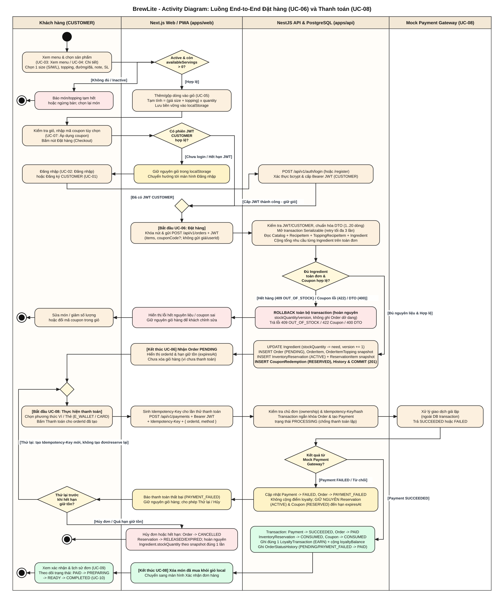

# Activity Diagram: Luồng End-to-End Đặt hàng và Thanh toán

Phiên bản 1.0 · 10/11/2026 · Phụ trách: Khải · [A2-2.1 / #7](https://github.com/akira-yami/BrewLite_A2/issues/7).

[Nguồn PlantUML](../diagrams/activity-checkout.puml) · [Nguồn Draw.io](../diagrams/activity-checkout.drawio) · [SVG](../diagrams/activity-checkout.svg) · [PNG](../diagrams/activity-checkout.png) · [PDF](../diagrams/activity-checkout.pdf).

---

## 1. Phạm vi và ranh giới Use Case

Sơ đồ mô hình hóa luồng nghiệp vụ end-to-end từ xem menu, chọn tùy chọn món, quản lý giỏ hàng, kiểm tra phiên đăng nhập, đặt đơn đến thanh toán mô phỏng và xem xác nhận đơn hàng, tuân thủ chặt chẽ [SRS](../requirements/srs.md), [Use-case tổng quát](../requirements/use-case-overview.md) và [UC-06: Đặt hàng](../requirements/uc-06-dat-hang.md):

- **Tách biệt ranh giới giữa hai Use Case trọng tâm**:
  - **UC-06: Đặt hàng** bắt đầu khi khách gửi yêu cầu tạo đơn (`POST /api/v1/orders`) và kết thúc khi đơn được tạo ở trạng thái `PENDING` kèm giữ chỗ nguyên liệu (`InventoryReservation` `ACTIVE` + `InventoryReservationItem` snapshot) và mã giảm giá (`CouponRedemption` `RESERVED` nếu có). Tại thời điểm kết thúc UC-06, hệ thống **chưa gọi cổng thanh toán** và **chưa xóa giỏ hàng**.
  - **UC-08: Thực hiện thanh toán** là use case độc lập sau UC-06, sử dụng `orderId` đã có cùng `Idempotency-Key` (`POST /api/v1/payments`) để tương tác với **Mock Payment Gateway**.
- **Không gộp enum trạng thái**:
  - `OrderStatus`: `PENDING`, `PAYMENT_FAILED`, `PAID`, `PREPARING`, `READY`, `COMPLETED`, `CANCELLED`.
  - `PaymentStatus`: `PROCESSING`, `SUCCEEDED`, `FAILED`.
  - `ReservationStatus`: `ACTIVE`, `CONSUMED`, `RELEASED`, `EXPIRED`.
  - `CouponRedemptionStatus`: `RESERVED`, `CONSUMED`, `RELEASED`, `EXPIRED`.

---

## 2. Cấu trúc Swimlane

| Swimlane | Vai trò / Trách nhiệm chính |
|---|---|
| **Khách hàng (`CUSTOMER`)** | Duyệt menu (`UC-03`), chọn size/topping/đường/đá/note (`UC-04`), kiểm tra giỏ và nhập coupon (`UC-05`, `UC-07`), đăng nhập khi thiếu phiên (`UC-02`), gửi đặt hàng (`UC-06`), chọn phương thức và thực hiện thanh toán hoặc retry (`UC-08`), xem xác nhận và lịch sử đơn (`UC-09`). |
| **Next.js Web / PWA (`apps/web`)** | Hiển thị trạng thái khả dụng (`availableServings`), gộp/lưu giỏ bền vững tại `localStorage`, kiểm tra phiên JWT trước khi checkout, giữ nguyên giỏ khi chuyển hướng login hoặc khi gặp lỗi tạo đơn/thanh toán, chỉ xóa các món đã mua khỏi giỏ sau khi xác nhận `PAID`. |
| **NestJS API & PostgreSQL (`apps/api`)** | Xác thực JWT/RBAC (`CUSTOMER`) và ownership, chuẩn hóa DTO, điều phối transaction `Serializable` kiểm tra công thức (`RecipeItem`, `ToppingRecipeItem`) và trừ tồn nguyên liệu (`Ingredient.stockQuantity`, `version`), tạo snapshot đơn/reservation/coupon, quản lý idempotency thanh toán, cập nhật trạng thái đơn và cộng điểm `LoyaltyTransaction` (`EARN`) đúng một lần. |
| **Mock Payment Gateway (`UC-08`)** | Actor tích hợp xử lý giao dịch giả lập (`E_WALLET` / `CARD`) bên ngoài DB transaction theo `Idempotency-Key`, trả kết quả thành công (`SUCCEEDED`) hoặc từ chối (`FAILED`). |

---

## 3. Các nút Decision / Merge và nhánh bắt buộc

| Nhánh kiểm tra (Decision / Merge) | Điều kiện rẽ nhánh | Hành vi hệ thống & Bảo toàn dữ liệu |
|---|---|---|
| **1. Kiểm tra khả năng phục vụ khi chọn món** | `[Hợp lệ]` vs `[Không đủ / Inactive]` | Nếu sản phẩm/biến thể/topping ngừng bán hoặc `availableServings = 0` theo công thức BOM, UI không cho thêm vào giỏ và báo khách chọn lại. Nếu hợp lệ, thêm/gộp dòng vào `localStorage`. |
| **2. Chưa đăng nhập / Hết hạn phiên (`UC-02`)** | `[Đã có JWT CUSTOMER]` vs `[Chưa login / Hết hạn JWT]` | Khi khách bấm **Đặt hàng** mà chưa có JWT `CUSTOMER` hợp lệ, Web **giữ nguyên giỏ hàng** trong `localStorage`, điều hướng sang `UC-02: Đăng nhập` (hoặc `UC-01: Đăng ký`). Sau khi nhận Bearer JWT, luồng **merge** quay lại màn hình Checkout với giỏ hàng nguyên vẹn (`AT-FR-04.2`, `AT-FR-05.3`). |
| **3. Hết hàng / Lỗi nguyên liệu hoặc Coupon (`UC-06`)** | `[Đủ nguyên liệu & Hợp lệ]` vs `[Hết hàng 409 OUT_OF_STOCK / Coupon 422 / DTO 400]` | Backend cộng tổng nhu cầu từng `Ingredient` qua `RecipeItem` (món) + `ToppingRecipeItem` (topping) nhân `quantity` trên toàn đơn. Nếu bất kỳ nguyên liệu nào không đủ tồn (`stockQuantity < need`), hết lượt retry conflict (`409 INVENTORY_CONFLICT`), hoặc mã giảm giá không hợp lệ (`422`), transaction **ROLLBACK toàn bộ** (hoàn nguyên `stockQuantity`/`version`, không tạo Order dở dang). Web **giữ nguyên giỏ hàng** để khách sửa món/số lượng/coupon (`AT-FR-06.3`, `AT-FR-06.4`). |
| **4. Thanh toán thất bại & Thử lại (`UC-08`)** | `[Payment SUCCEEDED]` vs `[Payment FAILED / Từ chối]` | Khi Mock Payment Gateway từ chối: cập nhật `Payment -> FAILED`, `Order -> PAYMENT_FAILED`, **không** cộng điểm loyalty, **giữ nguyên** `InventoryReservation` (`ACTIVE`) và `CouponRedemption` (`RESERVED`) đến `reservationExpiresAt`, đồng thời **giữ nguyên giỏ hàng**. |
| **5. Quyết định Retry hoặc Hủy / Hết hạn giữ tồn** | `[Thử lại]` vs `[Hủy đơn / Quá hạn giữ tồn]` | - **Thử lại (Retry)**: Khách tạo `Idempotency-Key` mới và gửi lại `UC-08` trên cùng `orderId` (đơn chuyển về `PENDING` trước attempt mới, **không tạo Order mới và không trừ nguyên liệu lần hai**) — luồng **merge** về bước chọn/gửi thanh toán. - **Hủy hoặc quá hạn**: Đơn chuyển sang `CANCELLED`, reservation/coupon chuyển sang `RELEASED` hoặc `EXPIRED`, hoàn nguyên `Ingredient.stockQuantity` theo `InventoryReservationItem` snapshot đúng một lần. |

---

## 4. Truy vết Yêu cầu (FR / UC / AC)

| Use Case | Mã FR / AC | Thể hiện trên Activity Diagram |
|---|---|---|
| `UC-03`, `UC-04` | `FR-01`, `FR-02`, `FR-03` (`AT-FR-02.2`, `AT-FR-03.1..3`) | Chọn 1 size (`S`/`M`/`L`), topping hợp lệ, đường/đá (`null` hoặc `0..100`), note (`<= 500`), kiểm tra `availableServings`. |
| `UC-05` | `FR-04` (`AT-FR-04.1..3`) | Gộp dòng cùng tùy chọn, tạm tính `(giá size + topping) x quantity`, persist `localStorage`, giữ giỏ qua login và khi lỗi, chỉ xóa món đã mua khi `PAID`. |
| `UC-01`, `UC-02` | `FR-05` (`AT-FR-05.2..3`) | Decision kiểm tra JWT `CUSTOMER`, nhánh chuyển hướng đăng nhập và merge quay lại checkout. |
| `UC-06`, `UC-07` | `FR-06`, `FR-10` (`AT-FR-06.1..4`, `AT-FR-10.1..2`) | Transaction `Serializable`, quy đổi BOM `RecipeItem` + `ToppingRecipeItem`, `UPDATE Ingredient` có điều kiện `version` & `stockQuantity`, tạo `Order` `PENDING` + `InventoryReservation` `ACTIVE` + `CouponRedemption` `RESERVED`, nhánh rollback `409 OUT_OF_STOCK`. |
| `UC-08` | `FR-07`, `FR-09`, `FR-10` (`AT-FR-07.1..5`, `AT-FR-10.3`) | Kiểm tra ownership + `Idempotency-Key`, tạo `Payment` `PROCESSING`, gọi Mock Payment Gateway ngoài tx, nhánh `SUCCEEDED` (`PAID`, `CONSUMED`, 1 `EARN`) và nhánh `FAILED` (`PAYMENT_FAILED`, retry key mới hoặc hủy/expire hoàn tồn 1 lần). |
| `UC-09`, `UC-10` | `FR-08`, `FR-09` (`AT-FR-08.1..3`, `AT-FR-09.1..3`) | Màn hình xác nhận và lịch sử đơn của chủ đơn, theo dõi tiến độ `PAID -> PREPARING -> READY -> COMPLETED`. |

---

## 5. Hướng dẫn chỉnh sửa và kết xuất

- **Nguồn PlantUML**: [`docs/diagrams/activity-checkout.puml`](../diagrams/activity-checkout.puml) (có thể render bằng PlantUML hoặc dán trực tiếp vào Draw.io qua menu `Arrange -> Insert -> Advanced -> PlantUML`).
- **Nguồn Draw.io**: [`docs/diagrams/activity-checkout.drawio`](../diagrams/activity-checkout.drawio) (mở trực tiếp bằng `app.diagrams.net` / Draw.io Desktop để chỉnh sửa kéo-thả từng khối swimlane và xuất lại SVG/PNG/PDF).
- **Bản xuất trong repo**:
  - Vector SVG: [`docs/diagrams/activity-checkout.svg`](../diagrams/activity-checkout.svg)
  - Ảnh PNG: [`docs/diagrams/activity-checkout.png`](../diagrams/activity-checkout.png)
  - Tài liệu PDF: [`docs/diagrams/activity-checkout.pdf`](../diagrams/activity-checkout.pdf)
