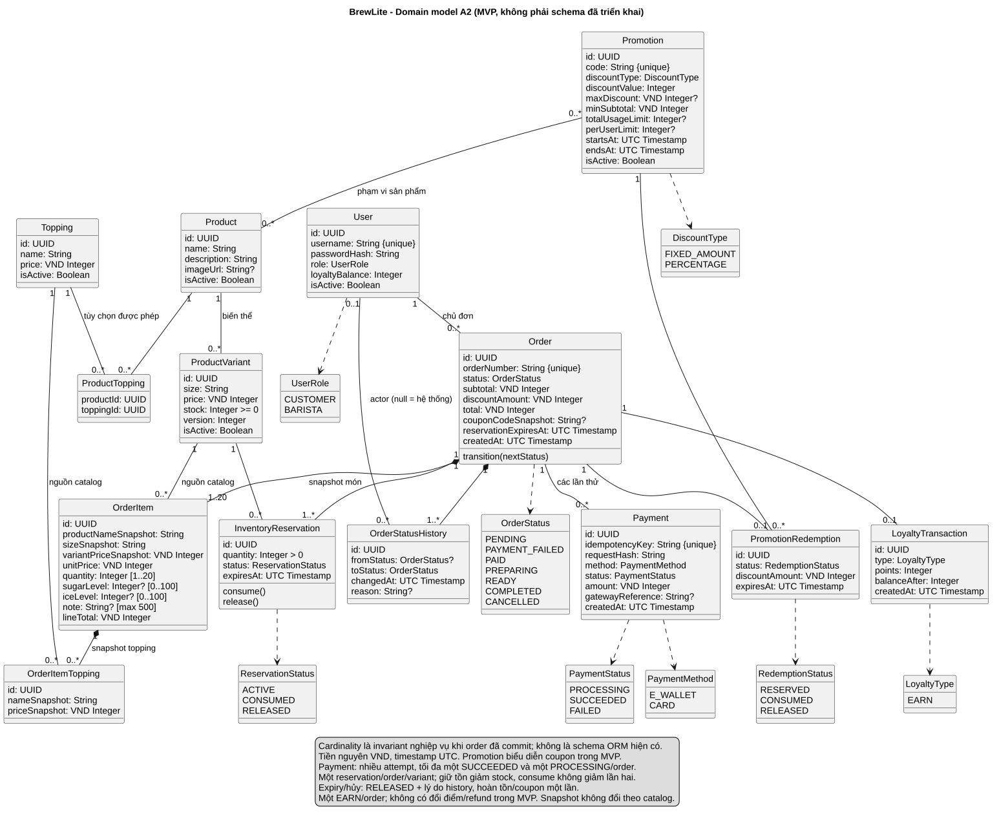

# Class diagram domain BrewLite

Phiên bản 1.0 · 04/11/2026 · [A2-2.3 / #10](https://github.com/akira-yami/BrewLite_A2/issues/10).

[Nguồn PlantUML](../diagrams/class-domain.puml) · [SVG](../diagrams/class-domain.svg) · [PNG](../diagrams/class-domain.png).



## Phạm vi và quy ước

Đây là mô hình domain đích A2 theo [SRS](../requirements/srs.md) và [kiến trúc](system-architecture.md). Baseline `00b7c69` chưa có schema/migration/runtime A2, nên cardinality trong hình là invariant nghiệp vụ, không khẳng định FK/index đã triển khai. Các kiểu VND Integer được lưu BIGINT theo ADR-002, serialize JSON trong miền số nguyên an toàn; UUID và thời gian UTC dùng chung toàn domain.

`Promotion` là lớp khuyến mãi được đề yêu cầu; trong MVP chỉ thể hiện coupon một mã/đơn. Nó tương ứng khái niệm Coupon ở tài liệu tham khảo A1, không tự mở rộng thành chương trình giảm giá tự động/chồng mã. PromotionRedemption lưu việc giữ/consume lượt, khác bản thân quy tắc Promotion. SRS chưa chốt danh sách size cụ thể nên size là String hợp lệ từ catalog, không tự bắt S/M/L.

## Quan hệ và invariant

| Nhóm | Cardinality / quy tắc nghiệp vụ |
|---|---|
| Catalog | Product có 0..* variant ở cấp lưu danh mục, nhưng chỉ mua khi có variant active/còn tồn. ProductTopping cho phép topping theo product. Topping không lặp trong một item |
| Order/items | Một customer sở hữu nhiều order; một order commit có 1..20 item, quantity mỗi item 1..20. Item/topping là snapshot thuộc order; catalog vẫn được tham chiếu nhưng không cập nhật snapshot cũ |
| Giá và tùy chọn | unitPrice = variantPriceSnapshot + tổng giá topping snapshot; lineTotal = unitPrice x quantity; subtotal = tổng lineTotal; total = subtotal - discountAmount >=0. Đường/đá/null/0/note không đổi giá; note trim tối đa 500 |
| Inventory | Một order có một reservation cho mỗi variant đã tổng hợp, không phải mỗi dòng. Unique (order,variant) và conditional stock/version cần được triển khai; consume không trừ stock lần hai |
| Payment | Một order nhiều attempt, tối đa một PROCESSING và một SUCCEEDED. Key unique và request hash bền vững, khóa order phân xử cả key khác nhau. Ownership trước replay; gateway gọi ngoài transaction dài |
| Promotion | Order có 0..1 redemption, liên kết đúng order/promotion; user được xác định qua chủ order, không lưu thêm quan hệ trùng trong mô hình domain. Hạn mức đếm giữ lượt và lượt đã dùng theo luật nghiệp vụ. Phạm vi product là tập áp dụng, tập rỗng nghĩa toàn menu theo contract đích; phải validate khi tạo đơn |
| Loyalty | MVP chỉ EARN sau success, 0..1 transaction cho mỗi order; ledger của user được truy qua các order của user; balance cập nhật cùng transaction với EARN. `floor(total/1000)` là tỷ lệ đề xuất ở SRS, cần xác nhận nghiệp vụ trước code |
| History | Order có history ban đầu và mọi transition; changedBy user có thể null khi hệ thống expiry. fromStatus null chỉ lúc khởi tạo |

Composition trong hình thể hiện sở hữu vòng đời snapshot/history, **không** chỉ thị cascade delete dữ liệu giao dịch. Không xóa order/history khi xóa/vô hiệu catalog hoặc user. Chỉ catalog/transaction hợp lệ sau commit mới phải đạt cardinality; bản ghi đang tạo dở chỉ tồn tại trong transaction.

## Enum và vòng đời

OrderStatus giữ đủ `PENDING`, `PAYMENT_FAILED`, `PAID`, `PREPARING`, `READY`, `COMPLETED`, `CANCELLED`. PaymentStatus là enum riêng `PROCESSING`, `SUCCEEDED`, `FAILED`; PaymentMethod chỉ `E_WALLET`, `CARD`. UserRole chỉ CUSTOMER/BARISTA; gateway không là role.

Reservation ACTIVE -> CONSUMED khi paid; ACTIVE -> RELEASED khi hủy/expiry đơn chưa paid. Redemption RESERVED -> CONSUMED hoặc RELEASED tương ứng. Expiry dùng RELEASED với reason trong history, chưa tạo enum EXPIRED mới ngoài contract A2. Hủy PAID trước PREPARING theo SRS giữ payment/coupon/điểm, chỉ hoàn tồn một lần trong transaction khóa order và chuyển PAID -> CANCELLED; reservation CONSUMED giữ dấu vết đã tiêu thụ, không gọi lại thao tác release ACTIVE. Order transition nguyên tử ngăn hai lần hoàn tồn và phân xử với nhận pha. Thanh toán chưa đối soát chặn cancel/expiry. Hai trạng thái cuối của order không chuyển tiếp.

Các ràng buộc unique/check/FK và state transition phải có migration/service/test thật; sơ đồ không chứng minh concurrency/idempotency đã đạt. Mô hình A2 chưa hỗ trợ redeem/adjust/reversal điểm, refund tiền thật hay role quản trị.

## Truy vết FR và kiểm chứng

| FR | Lớp liên quan | Ca chấp nhận |
|---|---|---|
| FR-01/02/03 | Product/Variant/Topping/ProductTopping, OrderItem snapshots | Active/options, null khác 0, note/quantity biên, tính giá |
| FR-05 | User, Order, Payment | JWT/role/ownership, không lộ password/hash hoặc replay khác chủ |
| FR-06 | Order/Item/Reservation/Redemption/History | Snapshot/transaction rollback, stock=5/20 request, tổng variant |
| FR-07 | Payment, Order, Reservation | Key/hash/replay/timeout/restart, một success/order |
| FR-08/09 | Order/History/Reservation | Snapshot/history riêng chủ, transition sai, cancel/prepare/expiry race |
| FR-10 | Promotion/Redemption/LoyaltyTransaction/User | Coupon limit=1 concurrent, total không âm, một EARN và balance nhất quán |

Đối chiếu [ADR-002](adr/002-postgresql-prisma.md), [ADR-004](adr/004-payment-inventory-consistency.md), [test plan TC-FR-03/05..10](../testing/test-plan.md). Tham khảo CD-01 A1 để nhận diện domain, nhưng không sao chép claim schema/commit/evidence của A1.

## Kết xuất

Java + [PlantUML 1.2026.8](https://github.com/plantuml/plantuml/releases/tag/v1.2026.8), từ root:

```powershell
java '-Djava.awt.headless=true' '-DPLANTUML_LIMIT_SIZE=16000' -jar C:/tools/plantuml-1.2026.8.jar -charset UTF-8 -tsvg docs/diagrams/class-domain.puml
java '-Djava.awt.headless=true' '-DPLANTUML_LIMIT_SIZE=16000' -jar C:/tools/plantuml-1.2026.8.jar -charset UTF-8 -tpng docs/diagrams/class-domain.puml
```

Commit nguồn và hai bản xuất; kiểm tra đủ bảy lớp bắt buộc, nhãn/multiplicity/enum và invariant với SRS trước nghiệm thu thiết kế.
