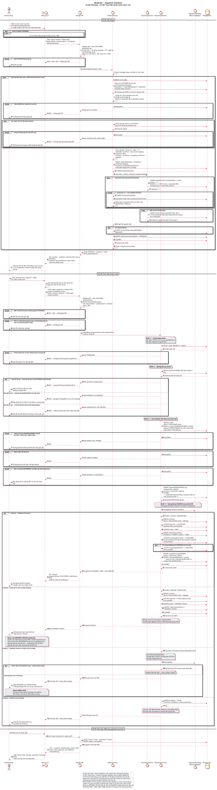

# Sequence checkout - Tạo đơn và ranh giới thanh toán

Phiên bản 1.0 · 04/11/2026 · [A2-2.2.1 / #8](https://github.com/akira-yami/BrewLite_A2/issues/8). Một sơ đồ `sequence-checkout` dùng chung UC-06/UC-08; phần payment gắn với [#9](https://github.com/akira-yami/BrewLite_A2/issues/9), tránh phát sinh hai sequence checkout mâu thuẫn.

[Nguồn PlantUML](../diagrams/sequence-checkout.puml) · [SVG](../diagrams/sequence-checkout.svg) · [PNG](../diagrams/sequence-checkout.png).



## Lifeline và trách nhiệm

| Lifeline | Trách nhiệm |
|---|---|
| Customer | Xác nhận giỏ, login khi cần, chọn phương thức và nhận kết quả |
| Next.js UI | Giữ giỏ, loading/validate client, gửi JWT/key, phân biệt success/decline/unknown |
| NestJS API | Guard/DTO, giá/ownership/state, service điều phối transaction; DB access qua repository/Prisma |
| Database | Catalog/snapshot/order/items, conditional stock/version, reservation/coupon/history, payment/ledger |
| Payment Service | Lifeline logic của service/gateway port; mock nằm trong API process, không suy ra container payment độc lập |

## Ranh giới transaction và nhánh lỗi

1. Tạo đơn: mọi bước catalog/coupon/order/items/stock/reservation/history cùng transaction. Order tồn tại trong transaction trước bản ghi FK orderId. Tổng quantity theo variant, thứ tự cập nhật ID ổn định, stock/version có điều kiện. Một lỗi dừng ngay các bước còn lại và rollback toàn bộ attempt.
2. Loop chỉ retry conflict tạm thời có giới hạn, luôn đọc/tính lại trong transaction mới; hết hàng trả 409, hết retry trả conflict. Số lần retry và TTL là cấu hình phải chốt khi triển khai, không sao chép 3 lần/15 phút của A1 thành ràng buộc A2.
3. Mất ACK COMMIT khác lỗi chắc chắn trước commit: không giả rollback hoặc tự retry tạo đơn. UI tra cứu trước khi tạo lại, vì POST /orders chưa có idempotency.
4. Payment bắt đầu sau order 201 PENDING. Kiểm tra JWT/chủ đơn trước truy xuất replay; key unique/hash không đủ thay khóa order để chặn hai key khác nhau. Chỉ gọi gateway khi attempt PROCESSING đã commit; gọi ngoài transaction dài.
5. Finalize success/decline là transaction mới; success consume reservation, không giảm stock lần hai, unique success và EARN bảo vệ side effect. Timeout hoặc finalize chưa rõ giữ dữ liệu để recovery lookup cùng key, không charge mới/expire/cancel khi chưa đối soát.

Code HTTP chắc chắn từ SRS: JWT 401, role/ownership 403 theo thiết kế, validation 400, hết tồn/conflict/reuse/in-progress 409, unknown payment 503 khi có response. Code chi tiết của coupon/DB cần chốt trong contract API, không gắn mã lỗi cũ A1 thành yêu cầu mới.

## Truy vết và kiểm chứng

| FR / AC | Phần sơ đồ | Ca dự kiến |
|---|---|---|
| FR-03/04, FR-05.2..4 | Giỏ/login, guard/DTO/ownership, UI giữ giỏ | TC-FR-03/04/05 trong test plan |
| AT-FR-06.1..4 | Toàn phần UC-06, transaction/rollback/conflict/unknown | TC-FR-06; stock=5/20 request, fault sau reserve |
| AT-FR-07.1..5 | UC-08, key/hash/replay/gateway/finalize/recovery | TC-FR-07; same/different-key, decline/timeout/restart |
| AT-FR-08.1..3 | Kết quả cuối và GET đơn | TC-FR-08; refresh không mutation mới |
| AT-FR-09.2, AT-FR-10.1..3 | Chặn expiry/cancel khi unresolved, coupon/loyalty | TC-FR-09/10, DB integration |

Tên rút gọn FR-05.2..4 ở bảng chỉ các AC AT-FR-05.2/.3/.4. Đây là thiết kế dựa trên [SRS](../requirements/srs.md), [NFR](../requirements/non-functional-requirements.md), [kiến trúc](system-architecture.md) và [ADR-004](adr/004-payment-inventory-consistency.md); [test plan](../testing/test-plan.md) chưa phải evidence chạy. Phần UC trọng tâm được theo dõi ở [#5](https://github.com/akira-yami/BrewLite_A2/issues/5)/#6; không giả định PR đó đã merge.

## Xuất lại

Java + [PlantUML 1.2026.8](https://github.com/plantuml/plantuml/releases/tag/v1.2026.8), từ root repo:

```powershell
java '-Djava.awt.headless=true' '-DPLANTUML_LIMIT_SIZE=16000' -jar C:/tools/plantuml-1.2026.8.jar -charset UTF-8 -tsvg docs/diagrams/sequence-checkout.puml
java '-Djava.awt.headless=true' '-DPLANTUML_LIMIT_SIZE=16000' -jar C:/tools/plantuml-1.2026.8.jar -charset UTF-8 -tpng docs/diagrams/sequence-checkout.puml
```

Nguồn và bản xuất đi cùng PR. Kiểm tra năm lifeline, nhánh break/alt/loop, JWT/validation, BEGIN/COMMIT/ROLLBACK, request/response và phản hồi cuối; không dùng render thành công để suy ra runtime/test đã đạt.
