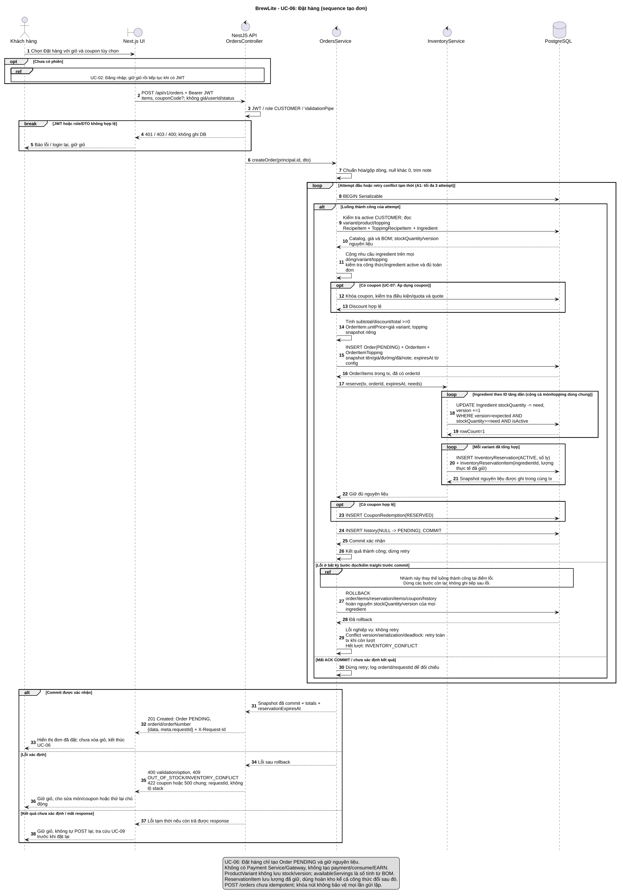

# Sequence UC-06: Đặt hàng

Phiên bản 1.1 · 04/11/2026 · [A2-2.2.1 / #8](https://github.com/akira-yami/BrewLite_A2/issues/8).

[Nguồn PlantUML](../diagrams/sequence-create-order.puml) · [SVG](../diagrams/sequence-create-order.svg) · [PNG](../diagrams/sequence-create-order.png).



## Phạm vi

Chỉ biểu diễn UC-06: Đặt hàng, đúng tên/ranh giới của [use case tổng thể](../requirements/use-case-overview.md). UC-02: Đăng nhập là tiền điều kiện; UC-07: Áp dụng coupon là nhánh extend. UC-08: Thực hiện thanh toán được đặc tả độc lập ở #6/#9, không xuất hiện thành lifeline hoặc request payment trong sequence này. Không merge hai UC thành một use case; luồng người dùng có thể tiếp tục UC-08 sau khi UC-06 đã kết thúc.

## Lifeline và nguồn code đối chiếu

Baseline tham chiếu [BrewLite_A1 @7beb0cb](https://github.com/akira-yami/BrewLite_A1/tree/7beb0cb06a2a89bc53a119bcb8d905cf596f548b), đọc ngày 04/11/2026:

| Lifeline | Trách nhiệm / source trong A1 |
|---|---|
| Khách hàng / Next.js UI | Xác nhận giỏ; login nếu cần, POST order, xử lý loading/lỗi và giữ giỏ |
| NestJS API / OrdersController | JWT/RolesGuard/DTO; gọi service với principal.id; trả 201/error envelope/requestId |
| OrdersService | normalize/validateAndPriceItems, transaction Serializable, coupon quote/reserve, snapshot/history, retry có giới hạn |
| InventoryService | needs.ingredients cộng toàn đơn, trừ nguyên liệu theo ID/version, ghi reservation và snapshot lượng đã giữ |
| PostgreSQL | Catalog/công thức/tồn/coupon/order/reservation/history dùng cùng transaction client |

Source: [OrdersService](https://github.com/akira-yami/BrewLite_A1/blob/7beb0cb06a2a89bc53a119bcb8d905cf596f548b/apps/api/src/modules/orders/services/orders.service.ts), [InventoryService](https://github.com/akira-yami/BrewLite_A1/blob/7beb0cb06a2a89bc53a119bcb8d905cf596f548b/apps/api/src/modules/inventory/services/inventory.service.ts), [InventoryRepository](https://github.com/akira-yami/BrewLite_A1/blob/7beb0cb06a2a89bc53a119bcb8d905cf596f548b/apps/api/src/modules/inventory/repositories/inventory.repository.ts), [Orders HTTP](https://github.com/akira-yami/BrewLite_A1/blob/7beb0cb06a2a89bc53a119bcb8d905cf596f548b/apps/api/src/modules/orders/http/orders-http.ts).

## Ranh giới transaction và lỗi

- Transaction đọc RecipeItem của variant và ToppingRecipeItem của mọi topping, nhân quantity và cộng theo ingredientId trên toàn đơn. Ingredient.stockQuantity/version mới là nguồn tồn; availableServings riêng một món không thay kiểm tra tổng nhu cầu các món dùng chung nguyên liệu.
- Tạo Order/items trước reservation có FK orderId; InventoryReservation mỗi order/variant lưu số ly, InventoryReservationItem lưu lượng nguyên liệu gồm món/topping. Coupon RESERVED và history cùng transaction. Một lỗi rollback cả stockQuantity/version và mọi bản ghi.
- A1 hiện retry tối đa 3 attempt tổng cộng cho version/serialization/deadlock/trùng orderNumber; lỗi hết nguyên liệu/option/coupon không retry. A2 triển khai lại cần giữ semantics này và kiểm chứng thực tế, không gọi source A1 là runtime A2.
- OrderItem.unitPrice lưu giá variant; topping price/quantity snapshot riêng; mapper tính lineTotal từ giá món + tổng topping rồi nhân item.quantity. Đổi đường/đá/note không đổi giá; code tham chiếu không điều chỉnh BOM theo mức đường/đá.
- Mất ACK COMMIT không được giả rollback hoặc tự retry POST /orders; đây là hành vi phục hồi đích cần test riêng, không tuyên bố đã được chứng minh bằng source transaction.
- Kết thúc thành công ở 201 PENDING; chưa gọi gateway, không PAID/PAYMENT_FAILED, không consume reservation/coupon, không EARN, chưa xóa giỏ.

## Truy vết

AT-FR-03.1..3 -> DTO/normalization/price; AT-FR-04.1..2 -> giỏ/login; AT-FR-05.2..3 -> JWT/role; AT-FR-06.1..4 -> snapshot/transaction/concurrency; AT-FR-10.1..2 -> quote/quota/coupon reserve. FR-07 và loyalty sau payment thuộc UC-08, không phải sequence này.

Xem [SRS](../requirements/srs.md), [NFR](../requirements/non-functional-requirements.md), [ADR-004](adr/004-payment-inventory-consistency.md), [test plan](../testing/test-plan.md). Fixture: món cần X=10, tồn X=50, 20 order mỗi order 1 ly không có nút thắt khác -> mục tiêu 5 order thành công, X=0, snapshot reservation tổng X=50. Thêm ca shared ingredient giữa variant/topping, thiếu BOM, inactive ingredient và fault sau reserve. Chưa có evidence chạy A2.

## Render

Java + PlantUML 1.2026.8, từ root repo:

```powershell
java '-Djava.awt.headless=true' '-DPLANTUML_LIMIT_SIZE=16000' -jar C:/tools/plantuml-1.2026.8.jar -charset UTF-8 -tsvg docs/diagrams/sequence-create-order.puml
java '-Djava.awt.headless=true' '-DPLANTUML_LIMIT_SIZE=16000' -jar C:/tools/plantuml-1.2026.8.jar -charset UTF-8 -tpng docs/diagrams/sequence-create-order.puml
```

Kiểm tra request/response, branch lỗi, BEGIN/COMMIT/ROLLBACK, giữ nguyên liệu và phản hồi cuối. Commit source/bản xuất cùng PR; phần rà soát Task 1–3 và mô hình BOM nằm trong PR #52.
