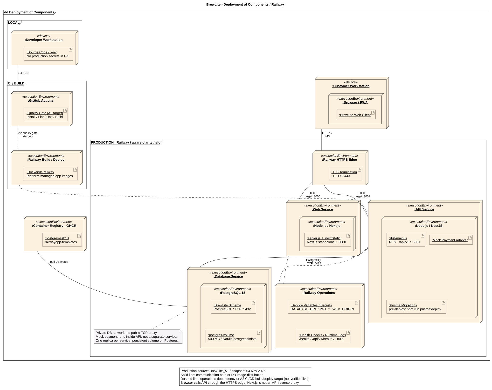

# Deployment production BrewLite - Railway

Phiên bản 1.3 · 05/11/2026 · [A2-3.2 / #16](https://github.com/akira-yami/BrewLite_A2/issues/16). Nền tảng Railway theo xác nhận của người dùng; [ADR-005](architecture/adr/005-railway-deployment.md) ghi quyết định và phần cần chuyển sang A2.

[Nguồn PlantUML](diagrams/deployment-production.puml) · [SVG](diagrams/deployment-production.svg) · [PNG](diagrams/deployment-production.png) · [Snapshot cấu hình không chứa secret](deployment/railway-snapshot.json).



## 1. Môi trường được đối chiếu

Đọc trực tiếp Railway project `aware-clarity`, environment `production`, region `sfo` ngày 04/11/2026. Web/API đang lấy source **akira-yami/BrewLite_A1**, không phải A2. Snapshot chỉ ghi cấu hình/ID trạng thái và tên biến, không lấy giá trị secret. A2 baseline `00b7c69` chưa có runtime/Dockerfile/migration/Compose chạy được; không dùng môi trường A1 để tuyên bố A2 đã deploy hoặc NFR đã đạt.

| Service | Cấu hình quan sát | Truy cập / kiểm tra |
|---|---|---|
| web | Root đang live `/apps/web/`; Dockerfile `/apps/web/Dockerfile.railway`, 1 replica sfo, port 3000 | [Web HTTPS](https://web-production-b910e.up.railway.app); probe `/health`, timeout 180s |
| api | Root `/apps/api/`; Dockerfile `/apps/api/Dockerfile.railway`, start `node dist/main.js`, 1 replica sfo, port 3001 | [API health HTTPS](https://api-production-1be6.up.railway.app/api/v1/health); pre-deploy `npm run prisma:deploy`, probe `/api/v1/health`, timeout 180s |
| Postgres | Image `ghcr.io/railwayapp-templates/postgres-ssl:18`, private endpoint `postgres`, 1 replica sfo | Volume `postgres-volume`, 500 MB, mount `/var/lib/postgresql/data`; không có public domain hoặc TCP proxy theo snapshot |

Ba deployment gần nhất có trạng thái SUCCESS trong inventory. Đây là trạng thái nền tảng, không thay health HTTP, demo mua hàng, log review, persistence test hoặc kết quả NFR. Có một thay đổi **chưa áp dụng** của Web: rootDirectory `/apps/web/` -> `/apps/web`; snapshot phân biệt live và staged, không tự apply/redeploy.

Project `vigilant-amazement` còn có service BrewLite_A1 FAILED, không có DB/volume và không dùng làm topology trong sơ đồ này.

## 2. Mạng, image, migration và vận hành

- Browser/PWA gọi Web và API qua hai domain HTTPS riêng, port public 443; Railway route tới target Web 3000 và API 3001. Client JS gọi API trực tiếp, không mặc định cho rằng Next.js proxy `/api/v1`. CORS cần khớp `WEB_ORIGIN` thực tế. Không có dịch vụ CDN riêng trong inventory, nên hình không dựng thêm CDN.
- API/migration kết nối PostgreSQL nội bộ port 5432 qua DATABASE_URL. Không đọc/ghi URL chứa credential vào hồ sơ; không public DB để vẽ cho tiện. Tên image postgres-ssl không đủ chứng minh kết nối API thực sự validate TLS nội bộ.
- Railway build Web/API từ Dockerfile source A1 và quản lý image deploy. Registry app/digest chưa có trong dữ liệu đọc được; không vẽ CI đã push image app lên GHCR. GHCR trong sơ đồ là registry thực của image PostgreSQL, [gói nguồn](https://github.com/railwayapp-templates/postgres-ssl).
- API có pre-deploy `npm run prisma:deploy` trước start. Không dùng seed/reset DB production; migrate fail phải chặn rollout ứng dụng. Chưa chạy migration hoặc fault injection trong tác vụ tài liệu này.
- Web Dockerfile build Next standalone và chạy `node server.js`; API Dockerfile build NestJS rồi `node dist/main.js`. Mock payment nằm trong API, không có container payment tiền thật. Persistent volume chỉ gắn Postgres; Web/API không có volume.
- Railway có health paths nêu trên; ứng dụng đích cần readiness kiểm tra DB 200/503, log JSON/requestId ra stdout với redaction. Snapshot chưa chứng minh log có requestId/không secret, DB outage hoặc recovery đạt ngưỡng.

## 3. Secret và khác biệt tên cấu hình A1/A2

| Cấu hình quan sát A1 | A2 đích / lưu ý |
|---|---|
| Web: NEXT_PUBLIC_API_URL, NODE_ENV, PORT, RAILWAY_DOCKERFILE_PATH | A2 mẫu dùng NEXT_PUBLIC_API_BASE_URL; cần chọn một tên và rebuild bundle khi đổi URL. Biến public không chứa secret |
| API: DATABASE_URL, JWT_SECRET/ISSUER/AUDIENCE/EXPIRES_IN | Server-only; cấp bằng platform env/secrets, không đưa vào Git/image/log |
| API: WEB_ORIGIN | A2 mẫu dùng CORS_ORIGIN; phải đồng bộ code và hosting, không mặc nhiên alias |
| API: MOCK_PAYMENT_MODE, ORDER_RESERVATION_TTL_MINUTES | A2 mẫu dùng PAYMENT_PROVIDER=mock, RESERVATION_TTL_SECONDS; khác cả đơn vị TTL, cần chuyển đổi có kiểm chứng |
| API: PORT, NODE_ENV, RAILPACK_NODE_VERSION, RAILWAY_DOCKERFILE_PATH | Source A1 dùng Dockerfile Node 24; A2 chưa khóa runtime, PR CI #49 đề xuất Node 22. Nhóm phải thống nhất trước tích hợp |

Tên biến không chứng minh giá trị đúng hoặc secret đang được rotate. Không xuất giá trị DATABASE_URL/JWT/PGPASSWORD vào snapshot hay PR.

## 4. Truy vết service tới kiến trúc và code

| Thành phần hình | Thành phần kiến trúc | Source đã đối chiếu | Phần A2 còn thiếu |
|---|---|---|---|
| Browser/PWA, Web | Next.js frontend | [A1 Web Dockerfile](https://github.com/akira-yami/BrewLite_A1/blob/main/apps/web/Dockerfile.railway), blob `76ddcd33651b0ab82e12870b51ea7cacdadd460f` | Runtime/Dockerfile tại apps/web; #22/#25/#26, PWA #14 |
| API + mock | NestJS modular monolith | [A1 API Dockerfile](https://github.com/akira-yami/BrewLite_A1/blob/main/apps/api/Dockerfile.railway), blob `4c1ea5c9b66b6c368633e64f4f56ff3d4aaffbdf` | Runtime apps/api, auth/order/pay #27–#29; port/env/readiness |
| PostgreSQL/volume/migration | Persistence/Prisma theo ADR-002 | [A1 schema](https://github.com/akira-yami/BrewLite_A1/blob/main/apps/api/prisma/schema.prisma), blob `4da34715fd7a2f2a939830421714d402e548538f`; platform pre-deploy config | Schema/migrations/seed #35, backup/restore/rollback #38. A2 đồng bộ Ingredient/RecipeItem/ToppingRecipeItem/InventoryReservationItem với A1 theo yêu cầu 04/11/2026 ở PR #52; chưa có migration/runtime A2 |
| Local | Cấu hình tái tạo môi trường | [.env.example](../.env.example), [apps/web](../apps/web/README.md), [apps/api](../apps/api/README.md) của A2 | Compose root còn rỗng, triển khai #36; local dự kiến 3000/3001/5432, không là production ports public |
| CI/CD, build/image | Quality gate/delivery | [Issue #24](https://github.com/akira-yami/BrewLite_A2/issues/24), [PR #49](https://github.com/akira-yami/BrewLite_A2/pull/49) và [#37](https://github.com/akira-yami/BrewLite_A2/issues/37) | Chưa có gate/deploy A2 được xác minh; không dùng Railway auto-build làm bằng chứng required checks |

Các đường dẫn A1 `main` là nguồn tham khảo đọc ngày 04/11/2026, blob SHA giúp nhận biết thay đổi; chưa xác minh chúng chính là commit đã deploy. Xem [kiến trúc A2](architecture/system-architecture.md), [SRS NFR](requirements/non-functional-requirements.md) và [test plan](testing/test-plan.md).

## 5. Các bước để nghiệm thu A2 production

1. Hoàn tất runtime/source/Dockerfile/migration, chọn Node/env thống nhất và CI có run pass/fail/required checks (#24). Không đổi source service đang chạy chỉ để làm sơ đồ khớp.
2. Cấu hình deploy A2 riêng hoặc chuyển nguồn có kế hoạch bằng #37–#39; ghi đúng repo/branch/commit/image digest, URL, health/log/network/volume thực tế sau deploy.
3. Kiểm tra HTTPS/mixed content/CORS và DB private; run smoke menu -> order -> mock pay -> confirmation/history; xác minh ownership và các NFR theo SRS.
4. Test persistence sau restart có giữ volume, backup/restore vào DB test và rollback app tương thích schema. Giữ evidence có command/UTC/commit/expected/actual, không log secret.
5. Cập nhật snapshot và nguồn/bản xuất cùng PR. Issue #16 chỉ đủ tiêu chí cuối A2 khi mapping service -> source A2 và topology deploy thực tế đã được xác minh.

## 6. Chỉnh sửa và kết xuất PlantUML

Nguồn chính là [deployment-production.puml](diagrams/deployment-production.puml). Sơ đồ dùng cú pháp PlantUML thực sự: frame, node, artifact, stereotype device/executionEnvironment, label instance gạch chân và quan hệ giữa các node. Các node 3D màu kem, runtime/artifact lồng nhau giữ phong cách UML của template. Layout được PlantUML tự tính từ graph và ràng buộc hướng, không giữ tọa độ tuyệt đối của Draw.io.

File PUML là nguồn duy nhất cho SVG/PNG trong PR này; không cần Draw.io, Pillow hoặc script render riêng. Dùng Java và [PlantUML 1.2026.8](https://github.com/plantuml/plantuml/releases/tag/v1.2026.8). Smetana là engine layout tích hợp được chọn bằng pragma trong nguồn, không cần cài Graphviz riêng.

Từ root repository, thay đường dẫn JAR theo máy:

```powershell
java '-Djava.awt.headless=true' '-DPLANTUML_LIMIT_SIZE=16000' -jar C:/tools/plantuml-1.2026.8.jar -charset UTF-8 -tsvg docs/diagrams/deployment-production.puml
java '-Djava.awt.headless=true' '-DPLANTUML_LIMIT_SIZE=16000' -jar C:/tools/plantuml-1.2026.8.jar -charset UTF-8 -tpng docs/diagrams/deployment-production.puml
```

Sửa PUML rồi render lại cả SVG và PNG trong cùng PR. SVG là vector để zoom/in rõ; kiểm tra nhãn, nested node, communication path, local/CI/production, registry/volume/env/health/log sau khi đổi layout. Không nhúng ảnh hoặc mã SVG/Draw.io trong file PUML.

Đường liền thể hiện communication path/phân phối image DB; nét đứt thể hiện phụ thuộc vận hành hoặc CI/CD A2 đích. Snapshot đối chiếu vẫn ngày 04/11/2026, source production A1; lần chuyển định dạng này không đọc lại live Railway và không thay cấu hình hay thực hiện deploy.
