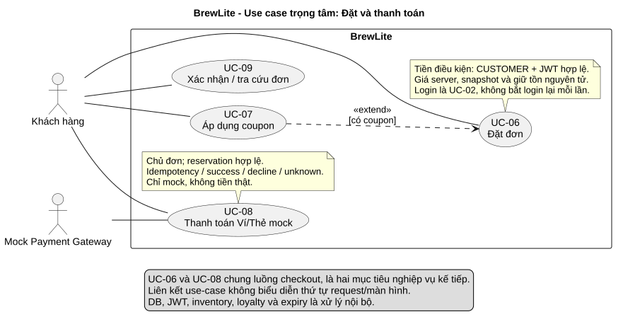

# Use case trọng tâm: Đặt và thanh toán đơn hàng

Phiên bản 1.0 · 04/11/2026 · [A2-1.3.1 / #5](https://github.com/akira-yami/BrewLite_A2/issues/5). Đặc tả nghiệp vụ dùng chung cho phần tạo đơn UC-06 và thanh toán UC-08; phần phối hợp thanh toán được truy vết tại [#6](https://github.com/akira-yami/BrewLite_A2/issues/6).

[Nguồn PlantUML](../diagrams/use-case-checkout.puml) · [SVG](../diagrams/use-case-checkout.svg) · [PNG](../diagrams/use-case-checkout.png).



## 1. Phạm vi và tác nhân

| Thuộc tính | Đặc tả |
|---|---|
| Mục tiêu | Khách nhận một đơn với giá server xác nhận, giữ được tồn và thanh toán Ví/Thẻ mock; kết quả truy xuất được sau reload |
| Tác nhân chính | Khách hàng có role CUSTOMER; khách chưa đăng nhập được chuyển qua UC-02 trước tạo đơn |
| Tác nhân hỗ trợ | Mock Payment Gateway cộng tác với UC-08; không có JWT role và không thu tiền thật |
| Trigger | Khách chọn Đặt đơn tại checkout với giỏ đã kiểm tra |
| Boundary | BrewLite Web/API và dữ liệu; DB, inventory, loyalty, JWT và expiry là xử lý nội bộ |
| Tiền điều kiện UC-06 | Giỏ không rỗng; phiên CUSTOMER hợp lệ khi gửi API; sản phẩm/tùy chọn và DB được backend kiểm tra lại, dữ liệu cache không bảo đảm còn tồn |
| Tiền điều kiện UC-08 | Có orderId của chủ đơn, reservation còn hợp lệ; không có payment chưa đối soát khác hoặc success trước đó; retry decline theo quy tắc bên dưới |
| Hậu điều kiện UC-06 thành công | Order PENDING, snapshot và tổng tiền bất biến; giảm tồn/giữ reservation, giữ lượt coupon nếu có và history ban đầu cùng commit; chưa thu tiền hoặc cộng điểm |
| Hậu điều kiện UC-08 thành công | Payment SUCCEEDED, Order PAID, consume reservation/coupon, history và một EARN/balance cùng commit; không giảm stock lần hai |
| Bảo đảm khi lỗi trước commit | Rollback toàn bộ thay đổi của transaction; không có dữ liệu dở dang hoặc stock âm; UI giữ giỏ |
| Giới hạn | Một quầy, VND nguyên, tối đa một coupon/đơn; không có giao hàng, hoàn tiền thật hoặc đặt/thanh toán offline |

UC-06 và UC-08 giữ nguyên ID của [danh mục UC](use-case-overview.md), không tạo hai use case tạo đơn khác nhau. Áp coupon UC-07 là `extend` của UC-06; login là tiền điều kiện, không `include` bắt đăng nhập lại mỗi lần. UC-08 thực hiện sau UC-06 nhưng quan hệ actor/UC không biểu diễn thứ tự màn hình. UC-09 là chức năng tiếp nối để xác nhận/tra cứu.

## 2. Luồng chính end-to-end

| Bước | Tác nhân / hệ thống | Kết quả |
|---|---|---|
| M1 | Khách kiểm tra size/topping/đường/đá/note/quantity và coupon tùy chọn | Web hiển thị tạm tính, kiểm tra giỏ và giữ dữ liệu khi chuyển login |
| M2 | Web gửi POST /api/v1/orders với Bearer JWT, items và couponCode tùy chọn | Không gửi giá/total/userId/status như dữ liệu quyết định nghiệp vụ; khóa nút gửi khi request đang xử lý |
| M3 | API kiểm tra JWT, role CUSTOMER, DTO và chuẩn hóa dòng | Một size; topping hợp lệ/không lặp; quantity 1..20, tối đa 20 dòng sau chuẩn hóa; đường/đá null hoặc nguyên 0..100, 0 khác null; note trim, tối đa 500, trắng thành null |
| M4 | API mở transaction, đọc catalog active và giá từ DB, kiểm tra/khóa coupon nếu có | Tính subtotal, discountAmount, total >=0; tên/giá/tùy chọn/note được snapshot |
| M5 | API tạo Order PENDING/items trước các bản ghi có FK orderId; tổng hợp số lượng theo variant và cập nhật stock/version có điều kiện theo thứ tự ID | stock >= quantity và version khớp mới giữ tồn; tạo reservation ACTIVE, coupon RESERVED nếu có, ghi history cùng transaction |
| M6 | Transaction commit; API trả 201 với orderId, trạng thái, snapshot/tổng tiền và hạn giữ tồn | Web chuyển bước thanh toán bằng orderId đã có, chưa báo thanh toán thành công |
| M7 | Khách chọn E_WALLET hoặc CARD; Web gửi POST /api/v1/payments với orderId/method và Idempotency-Key | Amount lấy từ order phía server; key giữ nguyên cho cùng một lần thử chưa rõ kết quả |
| M8 | API kiểm tra JWT/chủ đơn trước replay; khóa order để tạo/đọc attempt theo key/hash | Chỉ một PROCESSING trên order kể cả khác key; key/hash và trạng thái được lưu bền vững |
| M9 | Payment Service gọi mock gateway ngoài transaction DB dài | Không khóa DB trong khi chờ mạng/gateway |
| M10 | Khi success xác định, API finalize trong transaction ngắn | Payment SUCCEEDED + Order PAID + consume reservation/coupon + history + một loyalty EARN/balance; unique constraint bảo vệ ghi lặp |
| M11 | Web nhận kết quả server, hiển thị mã đơn/số tiền/trạng thái; chuyển xác nhận UC-09 | Chỉ xóa phần giỏ đã thuộc đơn thành công; món thêm sau checkout được giữ, refresh không tạo/pay lại |

## 3. Luồng thay thế

| Mã / tại bước | Điều kiện | Cách xử lý và nơi tiếp tục |
|---|---|---|
| A1 / M1–M3 | Chưa login hoặc JWT hết hạn | Login UC-02, giữ giỏ, quay checkout; API không tạo đơn cho request 401 |
| A2 / M4 | Không có coupon | discountAmount=0, không tạo redemption; tiếp tục M5 |
| A3 / M3–M5 | Cùng variant nhưng khác topping/đường/đá/note | Giữ item riêng; tổng hợp quantity theo variant khi giữ tồn. Cùng mọi lựa chọn chuẩn hóa thì gộp trong giới hạn |
| A4 / M5 | Version/serialization conflict nhưng còn đủ hàng | Rollback, retry toàn transaction có giới hạn theo config, đọc lại giá/tồn/coupon; không retry một phần. Không cố định số lần/TTL từ A1 thành yêu cầu A2 |
| A5 / M8 | Cùng key/hash đã hoàn tất | Trả kết quả attempt đã lưu, không charge hoặc side effect mới; ownership vẫn kiểm tra trước replay |
| A6 / M8 | Cùng attempt còn PROCESSING hoặc attempt khác đang xử lý trên order | 409 PAYMENT_IN_PROGRESS, Web tra cứu/gửi lại cùng key; không khởi tạo charge mới |
| A7 / M9 | Gateway từ chối xác định | Payment FAILED, Order PAYMENT_FAILED, không EARN; giữ reservation/coupon đến hạn. Chủ đơn retry bằng key mới, về PENDING trước attempt mới, không giữ tồn lần hai |
| A8 / sau M6 | Chủ đơn hủy hoặc hệ thống expire đơn chưa paid | Chỉ khi không có payment chưa đối soát; chuyển CANCELLED, release reservation/coupon và hoàn stock một lần theo FR-09 |
| A9 / sau M10 | Chủ đơn hủy PAID trước PREPARING | Theo SRS: hoàn tồn một lần nhưng giữ payment/coupon/điểm, không refund. Race với Barista nhận pha chỉ một transition commit |

## 4. Luồng ngoại lệ và bảo đảm dữ liệu

| Mã / tại bước | Tình huống | Phản hồi / bảo đảm |
|---|---|---|
| E1 / M3 hoặc M8 | Thiếu/sai/hết hạn JWT; role sai; không phải chủ đơn | 401 cho xác thực, 403 cho sai quyền; không lộ kết quả payment/đơn khác, không đổi DB |
| E2 / M3 | Sai DTO/quantity/note/option hoặc trường tự áp giá/quyền | 400, không ghi DB; Web chỉ vị trí lỗi và giữ giỏ |
| E3 / M4 | Catalog inactive/option sai product hoặc coupon sai/hết hạn/hết lượt | Không tạo đơn; báo lỗi để sửa/bỏ mã hoặc chọn lại món, không tự âm thầm bỏ coupon. HTTP code chi tiết ngoài nhóm validation cần chốt trong API contract |
| E4 / M5 | Hết hàng theo tổng variant | 409, rollback order/items/stock/version/reservation/coupon/history; Web giữ giỏ và yêu cầu sửa |
| E5 / M4–M6 | DB lỗi trước commit xác định, hoặc hết retry cạnh tranh | Rollback toàn attempt, không trả 201; lỗi tạm thời/nghiệp vụ có code/requestId, lỗi nội bộ không lộ stack. Hết retry không được giả báo hết hàng |
| E6 / M6 | Mất response/ACK commit khi tạo đơn | Kết quả chưa xác định: giữ giỏ, đối chiếu lịch sử/chi tiết trước khi chủ động tạo lại. POST /orders chưa có idempotency; khóa nút không bảo vệ khỏi mọi lần gửi lại |
| E7 / M8 | Cùng key nhưng khác order/method/hash | 409 IDEMPOTENCY_KEY_REUSED, không charge; order đã PAID cũng không có success thứ hai bằng key mới |
| E8 / M9–M10 | Timeout gateway hoặc gateway success nhưng finalize DB chưa xác định | Trả 503 tạm thời nếu trả được response; giữ PROCESSING và reservation để đối soát bằng lookup bền vững theo key, rồi finalize idempotent; không tự FAILED/hoàn tồn/charge key mới |
| E9 / mọi bước Web | Mất mạng/offline, storage giỏ lỗi | Có thông báo và retry chủ động; storage lỗi không crash; không queue đặt/pay hoặc cache response nhạy cảm, không xác nhận giả |

## 5. Truy vết yêu cầu và ca chấp nhận

| FR / AC | Luồng | Kiểm chứng theo SRS |
|---|---|---|
| FR-03 / AT-FR-03.1..3 | M1/M3/M4, A3, E2 | Null khác 0; note 500/501; size 50.000 + topping 7.000 x2 =114.000; payload sai không ghi DB |
| FR-04 / AT-FR-04.1..3 | M1/M11, A1, E6/E9 | Giỏ persist/gộp/tách; fail/unknown giữ giỏ; success chỉ xóa phần đã mua |
| FR-05 / AT-FR-05.2..4 | M3/M8, A1/A5, E1 | JWT/role/ownership; khách B đọc/pay/cancel/replay đơn A bị từ chối |
| FR-06 / AT-FR-06.1..4 | M2–M6, A2–A4, E3–E6 | Giá/chủ server, snapshot, fault rollback; stock=5/20 request chỉ 5 order và stock=0, ACTIVE tổng=5 |
| FR-07 / AT-FR-07.1..5 | M7–M10, A5–A7, E7/E8 | E_WALLET/CARD, key/hash/replay, same/different-key concurrency, decline/retry/timeout/restart |
| FR-08 / AT-FR-08.1..3 | M11, E6 | Confirmation/history server, refresh không mutation mới, snapshot cũ giữ nguyên |
| FR-09 / AT-FR-09.1..3 | A8/A9, E8 | Transition/hủy/expiry hợp lệ, không release khi unresolved payment, race chỉ một commit |
| FR-10 / AT-FR-10.1..3 | M4/M5/M10, A2/A7/A8 | Quota coupon nguyên tử; total không âm; một EARN/order, tỷ lệ điểm theo SRS đề xuất |

NFR liên quan: NFR-02/03/04/05/07/08/10/12. Mọi phép thử trên là điều kiện nghiệm thu, chưa phải kết quả chạy. Xem [SRS](srs.md), [NFR](non-functional-requirements.md), [kiến trúc](../architecture/system-architecture.md), [ADR-004](../architecture/adr/004-payment-inventory-consistency.md), [test plan](../testing/test-plan.md).

## 6. Sửa và xuất sơ đồ

Sửa nguồn `.puml`, giữ nguyên UC-06/07/08/09 và actor. Dùng Java + [PlantUML 1.2026.8](https://github.com/plantuml/plantuml/releases/tag/v1.2026.8), chạy từ root repository (đường dẫn JAR tùy máy):

```powershell
java '-Djava.awt.headless=true' '-DPLANTUML_LIMIT_SIZE=16000' -jar C:/tools/plantuml-1.2026.8.jar -charset UTF-8 -tsvg docs/diagrams/use-case-checkout.puml
java '-Djava.awt.headless=true' '-DPLANTUML_LIMIT_SIZE=16000' -jar C:/tools/plantuml-1.2026.8.jar -charset UTF-8 -tpng docs/diagrams/use-case-checkout.puml
```

Nguồn và hai bản xuất commit cùng PR; kiểm tra nhãn/actor/extend/boundary đọc được. Tham khảo UC-06 của BrewLite A1 để tổ chức luồng, nhưng TTL/retry/status và AC lấy từ baseline A2, không sao chép approval hoặc evidence A1.
