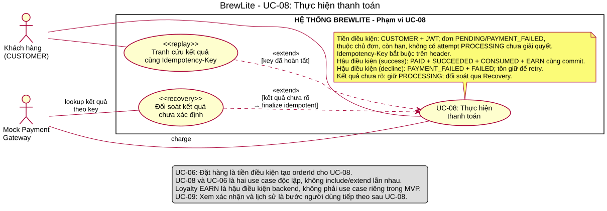

# UC-08 Thực hiện thanh toán

[Nguồn Use Case](../diagrams/use-case-uc08.puml) · [SVG](../diagrams/use-case-uc08.svg) · [Sequence checkout](../diagrams/sequence-checkout.svg) · [Sequence UC-08 chi tiết](../diagrams/sequence-payment.svg).

## Tác nhân và điều kiện

Khách hàng đã đăng nhập và sở hữu đơn `PENDING` hoặc `PAYMENT_FAILED` còn hạn thanh toán. Khách chọn thanh toán từ checkout hoặc thử lại từ màn hình đơn. VNPay là dịch vụ tích hợp. API dùng JWT, role `CUSTOMER` và `Idempotency-Key`. Số tiền lấy từ `Order.total`.

## Luồng chính

1. Web gửi `POST /api/v1/payments` với `{orderId, method: "VNPAY"}`. API kiểm tra quyền sở hữu, trạng thái đơn, hạn giữ chỗ và attempt đang xử lý.
2. PaymentsService tạo URL ký và lưu Payment `PROCESSING` trong transaction. API trả HTTP 200 với `{data: {status, paymentUrl, ...}}`. Web chuyển trình duyệt đến VNPay.
3. API xác thực IPN theo chữ ký, mã giao dịch và số tiền. Return chuyển trình duyệt về checkout. Với Sandbox, Return hợp lệ cũng có thể chốt giao dịch. Các callback có thể đến theo thứ tự khác nhau hoặc lặp lại.
4. Khi thành công và đơn còn hợp lệ, một transaction ghi `SUCCEEDED`, `PAID`, lịch sử trạng thái, consume reservation và coupon nếu có, và cộng `floor(total / 10)` điểm một lần.
5. Web tra `GET /api/v1/payments/status` bằng cùng key và có thể đọc `GET /api/v1/orders/:id` để xác nhận. Khách được dẫn sang màn xác nhận và lịch sử UC-09.

## Thay thế và ngoại lệ

| Trường hợp | Kết quả |
|---|---|
| Gửi lại cùng key và cùng payload | Trả trạng thái đã lưu. Attempt VNPay đang xử lý có thể trả lại URL. Request hash bao gồm orderId, method và amount. |
| Tái dùng key với hash khác | HTTP 409 `IDEMPOTENCY_KEY_REUSED`. |
| Đơn đã trả, hết hạn hoặc có attempt khác đang xử lý | HTTP 409, giữ attempt hiện có và không mở giao dịch mới. |
| VNPay chưa cấu hình | HTTP 503 `VNPAY_NOT_CONFIGURED`. |
| Thất bại xác định | `FAILED` và `PAYMENT_FAILED` nếu đơn còn `PENDING`. Đơn còn hạn có thể về `PENDING` trong attempt mới với key mới. |
| Chưa có kết quả | Web tiếp tục tra trạng thái hoặc cho khách theo dõi đơn. |
| Thành công muộn sau khi không thể chốt đơn | Backend ghi `MANUAL_REVIEW` và audit. Web hiển thị trạng thái cần đối soát. |

## Truy vết và phạm vi demo

UC-08 liên kết FR-07, FR-08, FR-09, FR-10 và [TC-FR-07](../testing/test-plan.md#tc-fr-07). Xem [Payment controller](../../apps/api/src/modules/payments/controllers/payments.controller.ts), [PaymentsService](../../apps/api/src/modules/payments/services/payments.service.ts) và [kiểm thử VNPay](../../apps/web/tests/e2e/vnpay/README.md). Đề bài nêu demo Ví/Thẻ mô phỏng. Hai phương thức mock này được giữ trong bộ test API. Luồng checkout của ứng dụng dùng VNPay.
