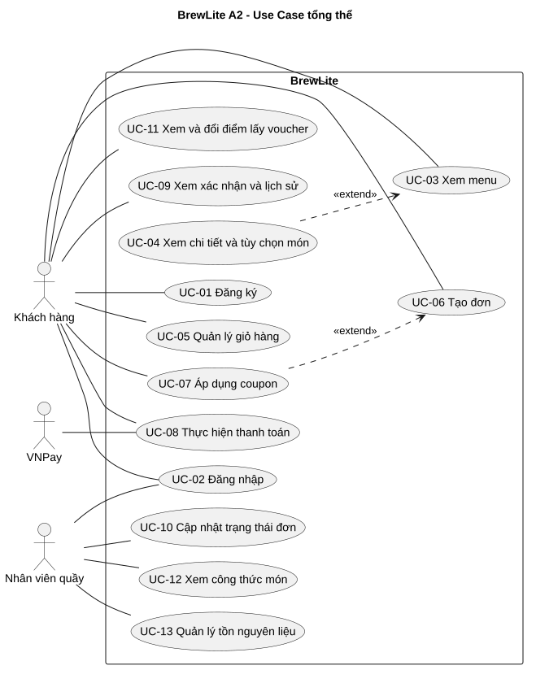

# Use Case tổng thể BrewLite A2

[Nguồn PlantUML](../diagrams/use-case-overview.puml) · [SVG](../diagrams/use-case-overview.svg) · [PNG](../diagrams/use-case-overview.png)

## Tác nhân

| Tác nhân | Vai trò |
|---|---|
| Khách hàng | Xem menu, tùy chỉnh món và dùng giỏ. Sau khi đăng nhập, khách đặt hàng, thanh toán, xem đơn và đổi điểm. |
| Nhân viên quầy | `BARISTA` đăng nhập, xem hàng đợi, đổi trạng thái đơn, xem công thức và điều chỉnh tồn nguyên liệu. |
| VNPay | Cung cấp trang thanh toán, gửi IPN và hỗ trợ QueryDr khi được cấu hình. |

## Truy vết

| Use Case | Yêu cầu hoặc hiện thực |
|---|---|
| UC-01 Đăng ký, UC-02 Đăng nhập | FR-05 |
| UC-03 Xem menu, UC-04 Xem chi tiết và tùy chọn món | FR-01, FR-02, FR-03 |
| UC-05 Quản lý giỏ hàng | FR-04 |
| [UC-06 Đặt hàng](uc-06-dat-hang.md), UC-07 Áp dụng coupon | FR-06, FR-10 |
| [UC-08 Thực hiện thanh toán](uc-08-thanh-toan.md) | FR-07, FR-10 |
| UC-09 Xem xác nhận và lịch sử | FR-08, FR-11 |
| UC-10 Cập nhật trạng thái đơn | FR-09, FR-12 |
| UC-11 Xem và đổi điểm lấy voucher | Mở rộng FR-10, `/loyalty` |
| UC-12 Xem công thức món, UC-13 Quản lý tồn nguyên liệu | Mở rộng nghiệp vụ quầy, `/barista/recipes` và `/barista/inventory` |

UC-04 mở rộng UC-03 khi khách chọn món. UC-07 mở rộng UC-06 khi khách có coupon. UC-06 tạo đơn `PENDING` trước khi khách thực hiện UC-08. Khách có thể hủy đơn của mình theo quy tắc vòng đời trong FR-09. Mock Ví/Thẻ nằm trong bộ test API.
