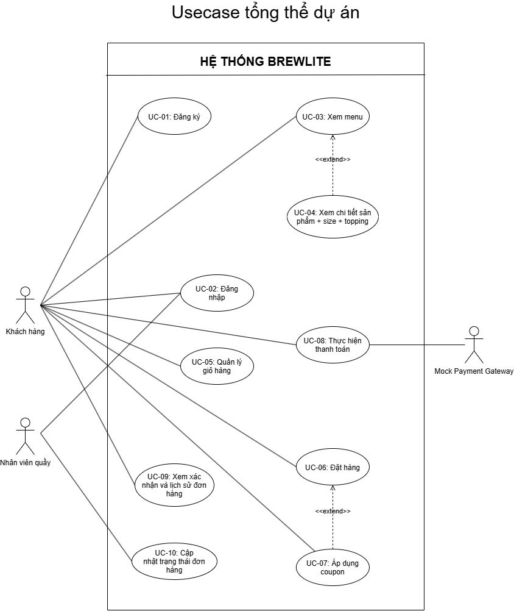

# BrewLite - Use-case diagram tổng quát

Phiên bản: 1.0 | Ngày: 28/10/2026 | Phụ trách: Khang | Truy vết: [A2-1.2.3 / Issue #4](https://github.com/phananhkhang/BrewLite_A2/issues/4).

Sơ đồ tổng thể chuẩn do nhóm cung cấp trong tệp `BrewLite diagram-Usecase.drawio.png`.

- [Nguồn Draw.io chỉnh sửa được](../diagrams/use-case-overview.drawio), trích nguyên vẹn từ metadata `mxfile` trong PNG của nhóm.
- [Bản xuất PNG gốc](../diagrams/use-case-overview.png), giữ nguyên nội dung và bố cục do nhóm thiết kế.

## 1. Actor và ranh giới

| Actor | Quyền / vai trò |
|---|---|
| Khách hàng | Chưa đăng nhập: đăng ký/đăng nhập, xem menu/detail, chọn tùy chọn và quản lý giỏ. Có role `CUSTOMER` mới tạo/thanh toán đơn, áp coupon tại checkout, đọc và hủy đơn của mình theo luật. |
| Nhân viên quầy / Barista | Đăng nhập với `BARISTA`; cập nhật `PAID -> PREPARING -> READY -> COMPLETED`. Không tự thanh toán hộ khách hay chuyển đơn sang PAID. |
| Mock Payment Gateway | Cộng tác với UC-08, trả success/decline hoặc kết quả chưa rõ. Đây là actor tích hợp logic, không phải tài khoản/JWT role; có thể cùng deployment qua adapter mock. |

Hình chữ nhật chứa chức năng do **BrewLite** chịu trách nhiệm, gồm web, API và dữ liệu do hệ thống quản lý. DB, inventory, loyalty, expiry job và việc kiểm tra JWT là xử lý nội bộ, không phải actor ngoài. Quản lý cửa hàng, giảng viên và nhóm phát triển là stakeholder; MVP không có use case quản trị dành riêng cho họ. Mô hình deployment vật lý được chốt ở Task 3, không suy ra từ vị trí gateway trên sơ đồ logic.

## 2. Ánh xạ use case với FR

FR-01..15 được đặc tả trong `docs/requirements/srs.md` thuộc [issue #2](https://github.com/phananhkhang/BrewLite_A2/issues/2); NFR ở `docs/requirements/non-functional-requirements.md` thuộc [issue #3](https://github.com/phananhkhang/BrewLite_A2/issues/3). Những PR này cần được merge trước khi nghiệm thu bộ SRS hoàn chỉnh. Sơ đồ chỉ vẽ MVP; các mở rộng được theo dõi ở bảng bên dưới.

| UC | Chức năng | FR / MoSCoW | Tiền điều kiện hoặc kết quả cần giữ |
|---|---|---|---|
| UC-01 | Đăng ký | FR-05 / Must | Public chỉ tạo CUSTOMER, không tự cấp BARISTA |
| UC-02 | Đăng nhập | FR-05 / Must | Khách/Barista nhận JWT hợp lệ; sai thông tin bị từ chối |
| UC-03 | Xem menu | FR-01 / Must | Public; active catalog; loading/empty/error |
| UC-04 | Xem chi tiết sản phẩm + size + topping | FR-02/03 / Must | Một size, topping hợp lệ; đường/đá/note là chi tiết tùy chọn trong SRS, không thêm UC mới |
| UC-05 | Quản lý giỏ | FR-04 / Must | Thêm/sửa/xóa, persist lựa chọn và giỏ, giữ giỏ khi lỗi |
| UC-06 | Đặt đơn | FR-06 / Must | CUSTOMER + giỏ hợp lệ; giá server; snapshot, giữ tồn và PENDING cùng transaction |
| UC-07 | Áp dụng coupon | FR-10 / Must | Tùy chọn khi checkout; server kiểm tra hạn/điều kiện/lượt dùng và total không âm |
| UC-08 | Thanh toán | FR-07/10 / Must | Chủ đơn, amount server, key bắt buộc; chống lặp, retry đúng luật; EARN một lần sau success |
| UC-09 | Xác nhận, chi tiết, lịch sử | FR-08 / Must; FR-11 / Should (phân trang) | Chỉ đọc đơn của mình, snapshot/timeline, tải lại lấy trạng thái mới |
| UC-10 | Cập nhật trạng thái đơn hàng | FR-09 / Must | Nhân viên quầy cập nhật tiến độ pha chế; transition sai 409 |

FR-12 (UI quầy đầy đủ, Could) là mở rộng UC-10; API tiến độ vẫn Must. FR-13 (refresh token, Could) mở rộng UC-02; FR-14 (realtime, Could) mở rộng UC-09. FR-15 (cổng tiền thật, Won't) ngoài MVP. Loyalty thuộc hậu điều kiện UC-08, không thêm actor hay use case đổi điểm.

## 3. Ý nghĩa quan hệ UML và quy tắc nhất quán

1. Đường liền là liên kết actor với chức năng, không biểu diễn thứ tự màn hình. Luồng Menu -> Detail -> Cart -> Checkout sẽ được mô hình bằng activity/sequence ở Task 2.
2. `UC-04 -> UC-03 <<extend>>`: mở detail từ menu là hành vi tùy chọn. `UC-07 -> UC-06 <<extend>>`: chỉ áp coupon nếu khách có mã. Arrow đi từ use case mở rộng tới use case gốc; việc coupon là tùy chọn cho mỗi đơn không làm FR-10 bớt bắt buộc phải được triển khai.
3. Đăng nhập là tiền điều kiện của đặt/thanh toán, không phải `include` bắt phải đăng nhập lại mỗi lần đặt đơn. UC-08 độc lập sau khi tạo đơn; thất bại có thể thử lại mà không tạo đơn/reserve lần hai.
4. Giữ đúng liên kết của sơ đồ nhóm: Khách hàng nối UC-01/02/03/05/06/07/08/09; Nhân viên quầy nối UC-02 và UC-10; Mock Payment Gateway nối UC-08. UC-04 được thể hiện qua quan hệ extend tới UC-03. Không tự thêm liên kết Khách hàng tới UC-04 hoặc UC-10.
5. Trạng thái Order là `PENDING`, `PAYMENT_FAILED`, `PAID`, `PREPARING`, `READY`, `COMPLETED`, `CANCELLED`; Payment dùng enum riêng `PROCESSING`, `SUCCEEDED`, `FAILED`. Không coi Payment SUCCEEDED là tên trạng thái Order.
6. Kiểm tra ownership áp dụng cả replay payment. Kết quả gateway chưa rõ phải được đối soát; không tự đổi sang FAILED hoặc giải phóng tồn. Các quy tắc này thuộc AC FR-05/07/09 và NFR consistency, không thêm use case kỹ thuật riêng.
7. Quy tắc hủy của chủ đơn thuộc FR-09 và các nhánh thay thế của vòng đời đặt/thanh toán/theo dõi đơn (UC-06/08/09), không đổi UC-10 thành use case hủy của Khách hàng. Chủ đơn chỉ hủy khi hợp lệ; luật hủy PAID giữ payment/coupon/điểm và hoàn tồn một lần là baseline cần PO review. Sơ đồ tổng thể không thay thế state machine hoặc đặc tả ngoại lệ chi tiết.

## 4. Chỉnh sửa, xuất lại và kiểm tra

Nguồn `.drawio` là XML gốc được nhúng trong ảnh do nhóm cung cấp, được giải mã URI từ metadata `mxfile`; không dựng lại hình bằng công cụ khác. Bản PNG trong repo có cùng SHA-256 với tệp được gửi, và XML nhúng khớp từng byte với nguồn `.drawio`.

1. Mở `docs/diagrams/use-case-overview.drawio` bằng Draw.io/diagrams.net.
2. Chỉnh sửa trên nguồn, giữ mã UC/actor thống nhất với SRS.
3. Lưu nguồn và xuất PNG với tùy chọn nhúng dữ liệu sơ đồ (**Include a copy of my diagram**), thay bản PNG trong cùng thư mục.
4. Mở lại PNG để kiểm tra nhãn, đường liên kết, boundary và nguồn nhúng; commit nguồn và bản xuất cùng một PR.

Kiểm tra hiện tại: XML đọc được, đủ 3 actor và UC-01..10; 2 quan hệ extend là UC-04 -> UC-03 và UC-07 -> UC-06; nguồn/bản xuất khớp; mỗi FR Must 01..10 có ánh xạ ở mục 2. Đặc tả use case trọng tâm A2 mục 3.3 thuộc issue khác.
